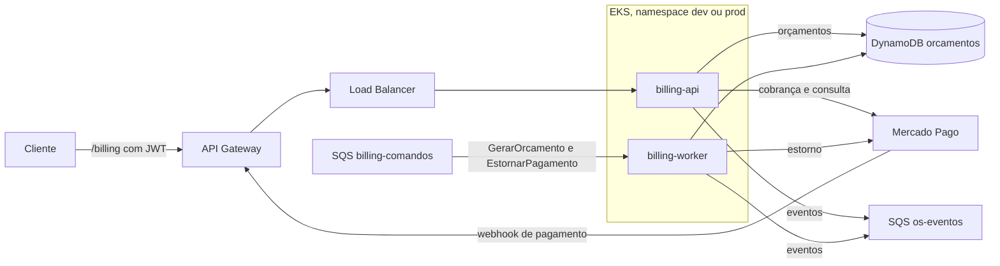

# fiap_tech_challenge_oficina_billing_service (Billing Service)

Microsserviço de orçamento e pagamento das ordens de serviço da oficina. Gera o orçamento, recebe a aprovação do cliente, cobra pelo Mercado Pago, confirma o pagamento e faz o estorno quando a Saga pede compensação. Faz parte do Tech Challenge Fase 4:

| Repositório | Responsabilidade |
|---|---|
| [fiap_tech_challenge_oficina_api](https://github.com/gabrielov2003/fiap_tech_challenge_oficina_api) | OS Service, orquestrador da Saga |
| fiap_tech_challenge_oficina_billing_service | Este repositório. Orçamentos e pagamentos |
| [fiap_tech_challenge_oficina_execution_service](https://github.com/gabrielov2003/fiap_tech_challenge_oficina_execution_service) | Fila de execução, diagnóstico e reparo |
| [fiap_tech_challenge_oficina_auth_lambda](https://github.com/gabrielov2003/fiap_tech_challenge_oficina_auth_lambda) | Autenticação por CPF e API Gateway |
| [fiap_tech_challenge_oficina_infra_k8s](https://github.com/gabrielov2003/fiap_tech_challenge_oficina_infra_k8s) | Rede, cluster EKS, registro de imagens, segredos e Datadog |
| [fiap_tech_challenge_oficina_infra_database](https://github.com/gabrielov2003/fiap_tech_challenge_oficina_infra_database) | Banco RDS PostgreSQL do OS Service |

## Tecnologias

Python 3.11, Flask, Flask-JWT-Extended, Flasgger, boto3, DynamoDB, SQS FIFO, Mercado Pago (Checkout Pro), Gunicorn, Datadog (ddtrace e DogStatsD), Docker, Kubernetes (EKS), Terraform e GitHub Actions.

## Arquitetura



Mesma estrutura hexagonal do OS Service: `domain.py` (orçamento e transições), `ports.py`, `application.py` (casos de uso), `infrastructure.py` (DynamoDB, SQS, Mercado Pago e Datadog), `web.py`, `worker.py` e `observabilidade.py`.

## Papel na Saga

A Saga é orquestrada pelo OS Service. O Billing recebe comandos pela fila e responde com eventos:

| Entrada | O que faz | Evento publicado |
|---|---|---|
| Comando `GerarOrcamento` | Grava o orçamento com os itens da OS | `OrcamentoGerado` ou `OrcamentoFalhou` |
| `POST /billing/orcamentos/{id_os}/aprovacao` com `aprovado: true` | Cria a cobrança no Mercado Pago e devolve o link | `OrcamentoAprovado` |
| `POST /billing/orcamentos/{id_os}/aprovacao` com `aprovado: false` | Recusa o orçamento | `OrcamentoRecusado` |
| Webhook do Mercado Pago, pagamento aprovado | Confirma o pagamento consultando a API do Mercado Pago | `PagamentoAprovado` |
| Webhook do Mercado Pago, pagamento recusado | Cancela a cobrança | `PagamentoRecusado` |
| Comando `EstornarPagamento` (compensação) | Estorna o pagamento no Mercado Pago | `PagamentoEstornado` |

Status do orçamento: Aguardando aprovação, Aguardando pagamento, Pago, Recusado, Cancelado e Estornado. Toda operação é idempotente: um comando ou webhook repetido publica de novo o evento do status atual, sem duplicar nada. Um pagamento aprovado que chega para um orçamento já cancelado é estornado na hora.

## Por que DynamoDB

O orçamento é um documento: os itens, o total, o status e os dados da cobrança são sempre lidos e gravados juntos, pela chave `id_os`. Não há consultas entre tabelas. O DynamoDB atende isso com escrita condicional (a troca de status só grava se o status lido ainda for o atual), não ocupa recursos do cluster, cobra por requisição e entra no free tier. Ele é o banco NoSQL da solução, junto com o PostgreSQL do OS Service.

## Mercado Pago

* A aprovação cria uma preferência do Checkout Pro com `external_reference` igual ao id da OS.
* O webhook é aceito só com assinatura válida (`x-signature`) quando `MP_WEBHOOK_SECRET` está configurado, e o status do pagamento é sempre confirmado consultando `GET /v1/payments/{id}` com o token do serviço.
* O estorno usa `POST /v1/payments/{id}/refunds` com chave de idempotência.
* Com credenciais de teste (`TEST-...`) o link devolvido é o do sandbox. Nos cartões de teste, o nome do titular `APRO` aprova e `OTHE` recusa.
* A URL do webhook é `<URL do gateway>/billing/webhooks/mercadopago`. O pipeline envia essa URL em cada cobrança quando o gateway já existe.

## Rotas e Swagger

| Rota | Acesso |
|---|---|
| `GET /billing/orcamentos/{id_os}` | Cliente dono da OS ou funcionário |
| `POST /billing/orcamentos/{id_os}/aprovacao` | Cliente dono da OS ou funcionário |
| `POST /billing/webhooks/mercadopago` | Mercado Pago |
| `GET /billing/health` e `GET /billing/ready` | Público |

Swagger: `<URL do gateway>/billing/apidocs/`.

## Testes e cobertura

```bash
python -m pip install -r requirements.txt -r requirements-dev.txt
python -m pytest --cov --cov-report=term-missing --cov-fail-under=80
```

Os testes usam o moto para simular DynamoDB e SQS e um Mercado Pago falso, então rodam sem AWS e sem internet. Cobrem geração, aprovação, recusa, webhook (aprovado, recusado, pendente, assinatura inválida, pagamento fora do fluxo), estorno, idempotência, mensagens inválidas e o adapter HTTP do Mercado Pago. A cobertura de cada execução fica no resumo do job `test`, na aba [Actions](https://github.com/gabrielov2003/fiap_tech_challenge_oficina_billing_service/actions). Última medição: 95%.

## Execução local

Com credenciais AWS e os recursos do ambiente `dev` já criados pelo pipeline:

```bash
cp .env.example .env
python src/app.py
python src/worker.py
```

## Infraestrutura (Terraform em `terraform/`)

Tabela DynamoDB `oficina-<env>-orcamentos`, fila FIFO `oficina-<env>-billing-comandos.fifo` com DLQ, role do IAM com acesso só aos recursos do serviço e associação do Pod Identity com a ServiceAccount `billing`. O estado fica em `billing-service/<env>.tfstate`.

## Kubernetes (`k8s/`)

`billing-api` (Deployment, Service LoadBalancer e HPA de 1 a 3), `billing-worker` (Deployment), ConfigMap, Secret e ServiceAccount, no namespace do ambiente.

## CI/CD

| Job | Quando roda | O que faz |
|---|---|---|
| `test` | Pull requests e pushes em `dev` e `main` | Testes com cobertura mínima de 80% |
| `quality` | Junto com o `test` | Ruff (erros e complexidade), Bandit (segurança) e `terraform validate` |
| `build` | Push em `dev` ou `main` | Build da imagem e push no ECR `oficina-billing` |
| `deploy` | Depois do build | Terraform do serviço, manifestos no namespace do ambiente e URL publicada em `/oficina/<env>/billing_url` |

`dev` publica em homologação e `main` em produção. Secrets: `AWS_ACCESS_KEY_ID`, `AWS_SECRET_ACCESS_KEY`, `MP_ACCESS_TOKEN` e, opcional, `MP_WEBHOOK_SECRET`. Variáveis: `TF_STATE_BUCKET` e, opcional, `AWS_REGION`.

---
Este projeto faz parte do Tech Challenge da Pós Graduação em Arquitetura de Software da FIAP.
